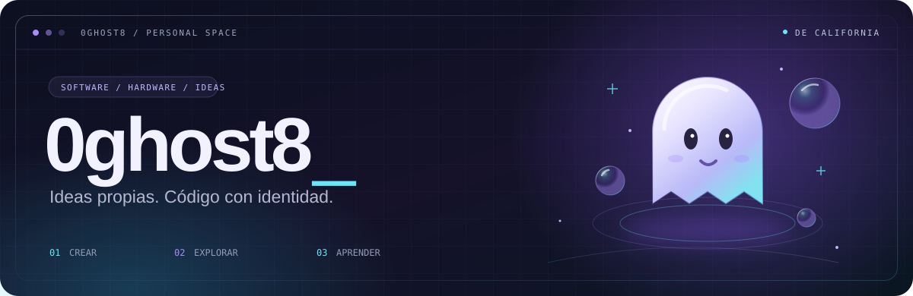

<!-- Perfil de 0ghost8. Guía de mantenimiento: docs/profile-design.md -->

# Hola, soy 0ghost 👋

**David · `0ghost8`**

  
  
  

 

[Sobre mí](#user-content-sobre-mi) &nbsp; · &nbsp; [Stack](#user-content-stack) &nbsp; · &nbsp; [Proyectos](#user-content-proyectos) &nbsp; · &nbsp; [Actividad](#user-content-actividad) &nbsp; · &nbsp; [Contacto](#user-content-contacto)

---

## 👻 Detrás de 0ghost8

Tengo **19 años** y estudio Informática en el **Centro Educativo Técnico Laboral Kinal **. Me apasiona entender cómo funcionan las cosas: desde una pieza de hardware hasta la arquitectura de una aplicación web.

Actualmente afino mis habilidades y me preparo para mis **prácticas profesionales de TI**.

- **Construyo de punta a punta.** Me enfoco en desarrollo Full Stack: bases de datos, APIs y experiencias de usuario.
- **También organizo al equipo.** He asumido el rol de **Scrum Master**, gestionando repositorios y tableros de Trello en proyectos estudiantiles.
- **Me gusta abrir la computadora, también.** Diagnóstico de hardware, mantenimiento de equipos y configuración de redes.

<b>🎧 Fuera del teclado</b>

 

🚴 **Ciclismo de ruta** para cambiar de ritmo. 
⛏️ **Servidores dedicados de Minecraft** para seguir experimentando. 
🫧 **Y2K y Frutiger Aero** como inspiración visual. 
🎵 **IDM, lo-fi y rock alternativo** en la playlist.

## 🧰 Mi caja de herramientas

**Frontend**

<picture>
  <source media="(prefers-color-scheme: dark)" srcset="https://skillicons.dev/icons?i=angular%2Cts%2Cjs%2Chtml%2Ccss&amp;theme=dark&amp;perline=6" />
  <source media="(prefers-color-scheme: light)" srcset="https://skillicons.dev/icons?i=angular%2Cts%2Cjs%2Chtml%2Ccss&amp;theme=light&amp;perline=6" />
  
</picture>

**Backend y datos**

<picture>
  <source media="(prefers-color-scheme: dark)" srcset="https://skillicons.dev/icons?i=java%2Cspring%2Cnodejs%2Cexpress%2Cmysql%2Ccpp&amp;theme=dark&amp;perline=6" />
  <source media="(prefers-color-scheme: light)" srcset="https://skillicons.dev/icons?i=java%2Cspring%2Cnodejs%2Cexpress%2Cmysql%2Ccpp&amp;theme=light&amp;perline=6" />
  
</picture>

**Herramientas**

<picture>
  <source media="(prefers-color-scheme: dark)" srcset="https://skillicons.dev/icons?i=git%2Cgithub%2Cdocker%2Cpostman&amp;theme=dark&amp;perline=6" />
  <source media="(prefers-color-scheme: light)" srcset="https://skillicons.dev/icons?i=git%2Cgithub%2Cdocker%2Cpostman&amp;theme=light&amp;perline=6" />
  
</picture>

  
  
  
  

## 🚀 Ideas que he llevado al código

<table>
<tr>
<td width="50%" valign="top">

### 🐾 Coda Garo

**Tecnología para encontrar un hogar.**

Plataforma de adopción de mascotas con gestión de imágenes en Cloudinary.

`Angular` `Node.js` `Cloudinary`

**Mi rol:** Scrum Master.

[Explorar proyecto →](https://github.com/0ghost8/CODA-GARO)

</td>
<td width="50%" valign="top">

### ♻️ EcoPlaca

**Otra oportunidad para el hardware.**

Aplicación web para concientizar y facilitar el reciclaje de basura electrónica y componentes.

`Angular` `TypeScript` `Hardware`

**Enfoque:** reciclaje y reutilización.

[Explorar proyecto →](https://github.com/0ghost8/EcoPlaca)

</td>
</tr>
</table>

| También en mi laboratorio | Qué estoy construyendo |
| :--- | :--- |
| 🤖 **Auto-Solver-GODTS** | Userscript en **JavaScript** que integra modelos **Llama a través de Groq** para la resolución asistida de tareas. |
| ☕ **Ecosistema Spring Boot** | Aplicaciones web y **APIs REST en Java**: *ElSurco* y [*ProyectoTiendaMinecraft*](https://github.com/0ghost8/ProyectoTiendaMinecraft-s-Vercions). |
| 🎨 **Mi Perfil Pablo** | Portafolio personal maquetado desde cero con **HTML y CSS puro**. |
| 🫧 **[Aero Glass](https://github.com/0ghost8/aero-glass-Pablo-Requena)** | Un espacio para explorar interfaces y mi gusto por la estética **Aero Glass**. |

  <a href="https://github.com/0ghost8?tab=repositories"><b>Ver todos mis repositorios ↗</b></a>

## 📈 Lo que voy construyendo en GitHub

  
  

Actividad de mi cuenta personal · Los lenguajes reflejan el código de mis repositorios públicos.

## 💬 Conectemos

Me interesa conversar sobre **desarrollo, hardware y proyectos con identidad propia**.

- **Correo:** [pablodrequena@gmail.com](mailto:pablodrequena@gmail.com)
- **Discord:** [Encuéntrame aquí](https://discord.com/users/784500933202542644)
- **Mi perfil académico:** [Pablo-Rf8 — formación y proyectos en Kinal](https://github.com/Pablo-Rf8)

### Menos ideas guardadas. Más cosas creadas.

Gracias por pasar por este rincón de GitHub. 👻

[Volver arriba ↑](#user-content-inicio)

  

Visuales con <a href="https://skillicons.dev/">Skill Icons</a>, <a href="https://shields.io/">Shields.io</a>, <a href="https://github.com/DenverCoder1/readme-typing-svg">Typing SVG</a>, <a href="https://github.com/kyechan99/capsule-render">Capsule Render</a> y <a href="https://github.com/anuraghazra/github-readme-stats">GitHub Readme Stats</a>.

